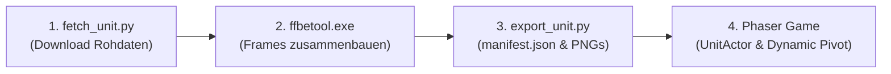

# FFBE Sprite-Pipeline Dokumentation

Diese Dokumentation beschreibt den standardisierten Ablauf, um beliebige Charaktere und Monster aus *Final Fantasy Brave Exvius (FFBE)* herunterzuladen, über `ffbetool` zusammenzusetzen, Pivots mathematisch zu berechnen und als spielbare Phaser-3-Assets bereitzustellen.

---

## 1. Übersicht & Architektur

Die FFBE-Rohdaten (Atlas-Textur, CGG-Frame-Daten und CGS-Animationsspuren) liegen im Community-Dump `DaddyRaegen/ffbe_asset_dump`.



- **Strikte Trennung:** Rohdaten und Tool-Binaries liegen in `tools/` bzw. `tools/test_input/`.
- **Spiel-Assets:** Das Phaser-Spiel in `src/` lädt ausschließlich fertig berechnete Spritesheet-PNGs und die standardisierte `manifest.json` aus `public/assets/units/<unit_name>/`.

---

## 2. Der 1-Befehl-Import (`tools/import_unit.py`)

Um eine neue Einheit komplett automatisiert zu importieren, genügt ein einziger Befehl im Projekt-Wurzelverzeichnis:

```powershell
py tools/import_unit.py --id <UNIT_ID> [--name <FOLDER_NAME>]
```

### Beispiele:
```powershell
# Cloud (5★, ID 207000105)
py tools/import_unit.py --id 207000105 --name cloud

# Aerith (5★, ID 207000405)
py tools/import_unit.py --id 207000405 --name aerith

# Rain (2★, ID 100000102)
py tools/import_unit.py --id 100000102 --name rain
```

> [!TIP]
> Wenn `--name` weggelassen wird, ermittelt das Skript den Namen automatisch aus `character_data.json` (z. B. `207000405` $\rightarrow$ `aerith`).

---

## 3. Die 3 Teilschritte im Detail

Falls ein Teilschritt manuell ausgeführt oder debuggt werden soll:

### Schritt A: Rohdaten beschaffen (`fetch_unit.py`)
```powershell
py tools/fetch_unit.py --id 207000405 -o tools/test_input
```
- Fragt den Online-Katalog ab.
- Lädt die Atlas-Textur (`unit_anime_<ID>.png`), CGG-CSV und alle Animations-CGS-Dateien gezielt nach `tools/test_input/` herunter, **ohne** das 3-GB-Repository klonen zu müssen.

### Schritt B: Sprites zusammenbauen (`ffbetool.exe`)
```powershell
.\tools\bin\ffbetool.exe 207000405 -i tools/test_input -o tools/test_output --json --gif -v
```
- Parst die Part-Transformationen (Rotation, Opazität, Position) und assembliert horizontale Spritesheets sowie Animations-JSONs nach `tools/test_output/`.
- **Wichtig:** Benötigt die lokale `character_data.json` im Arbeitsverzeichnis, um Offline-Ausführung ohne Remote-Netzwerkfehler zu garantieren.

### Schritt C: Asset-Export & Pivot-Berechnung (`export_unit.py`)
```powershell
py tools/export_unit.py --id 207000405 --name aerith
```
- Kopiert die Spritesheet-PNGs (z. B. `idle.png`, `move.png`, `atk.png`, `magic_atk.png`, `win.png`) nach `public/assets/units/aerith/`.
- Erzeugt die konsolidierte `manifest.json`.

---

## 4. Struktur der `manifest.json` & Pivot-Mathematik

Da FFBE-Animationen unterschiedlich große Bounding-Boxes haben (z. B. 61×66 bei `idle` vs. 178×139 bei `atk`), schneidet `ffbetool` jede Animation auf ihr minimales `frameRect` zu.

Der Welt-Ursprungspunkt/Fußpunkt liegt auf der virtuellen 2000×2000-Leinwand bei `(1000, 1000)`.
Die `export_unit.py` berechnet den normierten Phaser-Pivot daher exakt:

$$\text{pivotX} = \frac{1000 - \text{frameRect.x}}{\text{frameRect.width}}, \quad \text{pivotY} = \frac{1000 - \text{frameRect.y}}{\text{frameRect.height}}$$

### Beispiel `manifest.json`:
```json
{
  "unitId": "207000405",
  "name": "aerith",
  "animations": {
    "idle": {
      "file": "idle.png",
      "frameWidth": 61,
      "frameHeight": 66,
      "frameCount": 4,
      "pivotX": 0.491803,
      "pivotY": 0.757576,
      "frames": [
        { "index": 0, "delayTicks": 10, "durationMs": 166.67 },
        { "index": 1, "delayTicks": 10, "durationMs": 166.67 },
        { "index": 2, "delayTicks": 10, "durationMs": 166.67 },
        { "index": 3, "delayTicks": 10, "durationMs": 166.67 }
      ]
    }
  }
}
```

---

## 5. Einbindung im Phaser-Spiel

### 1. In `BootScene.ts` Manifest laden:
```typescript
this.load.json('aerith_manifest', 'assets/units/aerith/manifest.json');
```

### 2. In `PreloadScene.ts` übergeben:
Die `PreloadScene` registriert alle Spritesheets aus der übergebenen Manifest-Map automatisch.

### 3. In `BattleScene.ts` instanziieren:
```typescript
const aerith = new UnitActor(this, 920, 310, 'aerith', manifests.aerith);
aerith.setScale(2.5);
aerith.setFacingLeft(true);
```

- Die `UnitActor`-Klasse wendet bei `playAnimation(animKey)` automatisch `setOrigin(pivotX, pivotY)` an.
- Bei horizontalem Wenden (`setFacingLeft(false)`) wird der X-Pivot automatisch auf `1.0 - pivotX` invertiert.
- Der Sprite springt niemals, egal welche Animation abgespielt wird!

---

## 6. Monster & Gegner importieren

Für Monster-Spritesheets wird `ffbetool` mit dem Flag `--unit_type monster` aufgerufen:

```powershell
.\tools\bin\ffbetool.exe <MONSTER_ID> -i tools/test_input -o tools/test_output --unit_type monster --json
py tools/export_unit.py --id <MONSTER_ID> --name <MONSTER_NAME> --output public/assets/monsters
```
